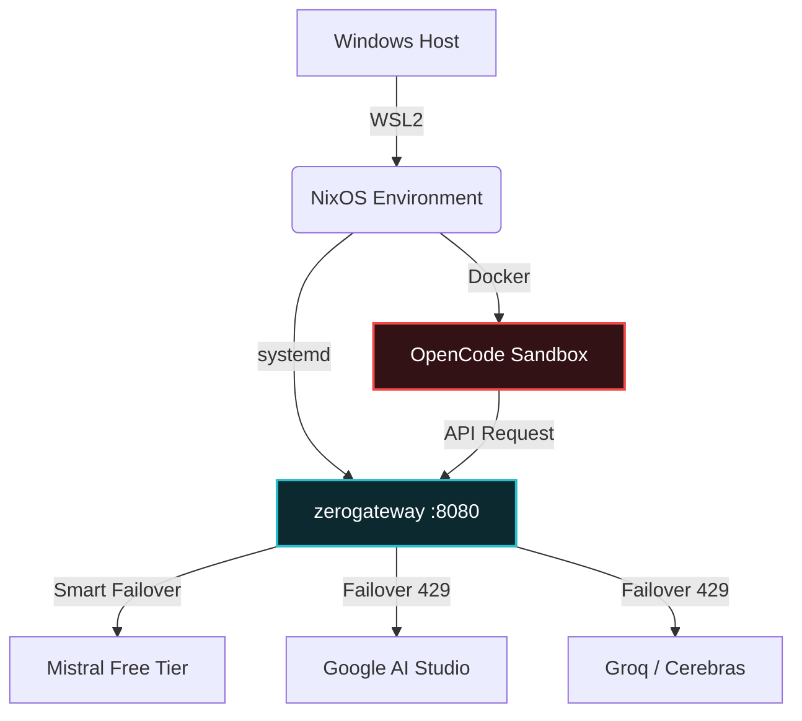

<div align="center">

# ⚡ l3rn4-nix ⚡

**The Declarative Infrastructure for the AI Rebellion.**

[](#)
[](#)
[](#)
[](#)
<br>

</div>

```text
           (\,;'\,;/)          L3RN4-NIX
            \       /          ---------
            /   _   \          "Cut off one head, two more shall take its place."
           |   ( )   |         
            \       /          [ Hydra Agent Environment ]
           /`\     /`\         
          /   `---'   \        
         /      |      \       
```

<div align="center">

---

## 🩸 The Manifesto: Free AI for the Masses

> *"They want you to pay $20 a month just to ask a machine to write a Python script. They want your keys, your data, and your monthly tithe. We say: **No.**"*

**l3rn4-nix** is not just a dotfiles repository. It is a statement. 
It is a fully declarative, reproducible, and **paranoid-secure** infrastructure designed to run autonomous AI agents (like OpenCode) for **exactly zero dollars**.

We do not beg for API limits. We pool them. We do not trust the agent with our personal files. We cage it. We do not rely on the cloud. We run it locally.

### 🛡️ The Three Pillars of the Hydra

1. **The Head (Agent):** OpenCode. A powerful MIT-licensed agent, isolated inside a Docker container. It writes code, runs tests, and learns — but it can *never* touch your Windows `C:\` drive or your SSH keys.
2. **The Neck (Aggregator):** `zerogateway`. A local proxy that rotates your free API keys (Mistral, Google, Groq, Cerebras) automatically. Hitting a `429 Too Many Requests`? It just switches the head.
3. **The Body (Host):** NixOS in WSL2. Pure, immutable, and declarative. If the system breaks, we roll back in seconds. If the SSD dies, we rebuild from a single `flake.nix`.

---

## 🏗️ Architecture



## 📂 Repository Structure

*   `flake.nix` / `configuration.nix` — The system's DNA. Fully declarative.
*   `cybrcore.toml` — Cyberpunk Starship prompt. Because if you're going to hack the mainframe, do it with style.
*   `fastfetch.jsonc` — Minimalist system fetch.
*   `nix-rebuild` — A custom wrapper that stages changes and rebuilds NixOS safely.
*   `modules/` — *(Coming soon)* Docker isolation and zerogateway systemd services.

---

## 🚀 Quick Start (For the Initiates)

> **Warning:** You need to know what you are doing. This is not a "Next -> Next -> Finish" installer.

```bash
# Clone the lore
git clone git@github.com:glitch-city-ghost/l3rn4-nix.git
cd l3rn4-nix

# Awaken the beast (requires NixOS with flakes enabled)
./nix-rebuild
```

---

<div align="center">

**"Code is free. Intelligence is free. The rest is just subscription fees."**

*Built with spite, caffeine, and Nix flakes.*

</div>
