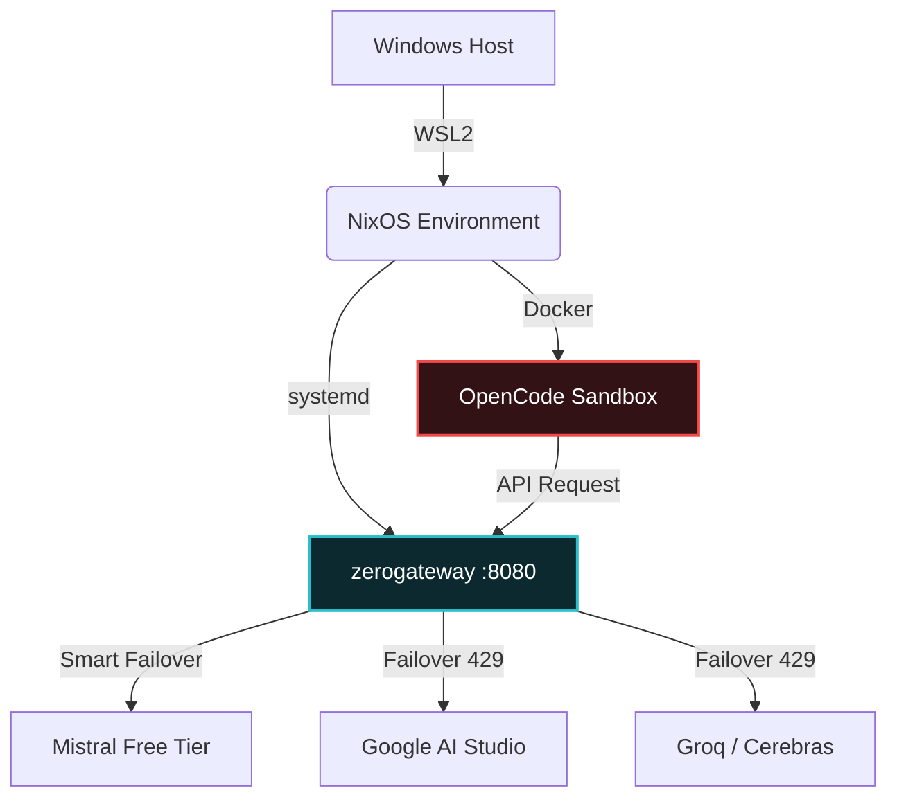

<div align="center">

# ⚡ l3rn4-nix ⚡

**The Declarative Infrastructure for the AI Rebellion.**

[](#)
[](#)
[](#)
[](#)
<br>

</div>

```text
           (\,;'\,;/)          L3RN4-NIX
            \       /          ---------
            /   _   \          "Cut off one head, two more shall take its place."
           |   ( )   |         
            \       /          [ Hydra Agent Environment ]
           /`\     /`\         
          /   `---'   \        
         /      |      \       
```

<div align="center">

---

## 🩸 The Manifesto: Free AI for the Masses

> *"They want you to pay $20 a month just to ask a machine to write a Python script. They want your keys, your data, and your monthly tithe. We say: **No.**"*

**l3rn4-nix** is not just a dotfiles repository. It is a statement. 
It is a fully declarative, reproducible, and **paranoid-secure** infrastructure designed to run autonomous AI agents (like OpenCode) for **exactly zero dollars**.

We do not beg for API limits. We pool them. We do not trust the agent with our personal files. We cage it. We do not rely on the cloud. We run it locally.

### 🛡️ The Three Pillars of the Hydra

1. **The Head (Agent):** OpenCode. A powerful MIT-licensed agent, isolated inside a Docker container. It writes code, runs tests, and learns — but it can *never* touch your Windows `C:\` drive or your SSH keys.
2. **The Neck (Aggregator):** `zerogateway`. A local proxy that rotates your free API keys (Mistral, Google, Groq, Cerebras) automatically. Hitting a `429 Too Many Requests`? It just switches the head.
3. **The Body (Host):** NixOS in WSL2. Pure, immutable, and declarative. If the system breaks, we roll back in seconds. If the SSD dies, we rebuild from a single `flake.nix`.

---

## 🏗️ Architecture



## 📂 Repository Structure

*   `flake.nix` / `configuration.nix` — The system's DNA. Fully declarative.
*   `themes/cyberpunk/starship/cybrcore.toml` — Cyberpunk Starship prompt, generated from `cyberpunk-palette.yaml` via `templates/starship/`. Because if you're going to hack the mainframe, do it with style.
*   `generators/` — template renderers (`generate-all.py`; `palette.py` is the engine).
*   `templates/` — human-readable config files with `@section.key@` palette placeholders.
*   `themes/cyberpunk/fastfetch/config.jsonc` — Minimalist system fetch (generated).
*   `nix-rebuild` — A custom wrapper that stages changes and rebuilds NixOS safely.
*   `dash.conf` — Dashboard layout and pane commands for the tmux dashboard.
*   `btop/` — btop config (the theme is generated under `themes/cyberpunk/btop/`).
*   `scripts/dash` / `scripts/proxy-status` — The tmux dashboard and its proxy status pane.
*   `modules/` — *(Coming soon)* Docker isolation and zerogateway systemd services.

---

## 🚀 Quick Start (For the Initiates)

> **Warning:** You need to know what you are doing. This is not a "Next -> Next -> Finish" installer.

```bash
# Clone the lore
git clone git@github.com:glitch-city-ghost/l3rn4-nix.git
cd l3rn4-nix

# Awaken the beast (requires NixOS with flakes enabled)
./nix-rebuild
```

## 📊 Dashboard (PoC)

A tmux dashboard for daily driving. Its layout and every pane command live in
`dash.conf`; the first pane is your interactive shell/agent, the rest are
ordinary processes:

| Pane | Default |
| --- | --- |
| shell | `$SHELL` — type here, or start a TUI such as `opencode` |
| logs | `journalctl -fu mihomo` |
| btop | `btop` with the `cyberpunk` theme; all four boxes (cpu, mem, net, proc) |
| proxy | read-only mihomo snapshot: service, controller, port, node, connections, traffic, egress |

```bash
./nix-rebuild
dash init            # copy dash.conf to ~/.config/l3rn4/dash.conf (once)
$EDITOR ~/.config/l3rn4/dash.conf
dash                 # create or attach

dash grid            # equal tiles, ignores the config layout (creation only)
dash config          # show the active config, layout and resolved panes
dash kill            # stop the dashboard
```

Panes are lines; the first one is the main pane in `main` layouts:

```bash
pane "shell" "${SHELL:-bash}"
pane "logs"  journalctl -fu mihomo -o short-iso --no-hostname
pane "btop"  btop --force-utf
pane "proxy" proxy-status
```

Anything executable works. For pipes or redirection wrap it in `bash -c`:

```bash
pane "errors" bash -c 'journalctl -fu mihomo | grep --line-buffered -Ei "error|fail"'
```

The repo ships `btop/btop.conf` and the generated theme at
`themes/cyberpunk/btop/cyberpunk.theme`; home-manager installs them under
`~/.config/btop/`. The theme uses the colors of
`cyberpunk-palette.yaml`. The config shows the stock four boxes
(`cpu mem net proc`), so `1`-`4` switch between them.

The config is WSL-specific: GPU monitoring is off. btop initialises NVML at
startup whenever `shown_gpus` contains `nvidia` (the default, even with no GPU
box shown), and that path is known to hang or spin on WSL2 — `shown_gpus` is
therefore empty. `terminal_sync` is off too, as a guard against Windows
Terminal/ConPTY stalls; re-enable it if your terminal handles synchronized
output correctly.

The dashboard pane is narrow, so all four boxes may not fit there. The `btop`
pane is 24 rows tall; `dash_tall_pane` / `dash_tall_height` set it, and the
two side panes keep at least 13 rows (`dash_side_height`). If btop reports
the terminal is too small, raise `dash_tall_height` or zoom the pane with
`<prefix> z`. `htop` remains installed as a fallback.

The file also sets `dash_layout` (`main`, `main-horizontal`, `grid`,
`horizontal`, `vertical`), `dash_main_width` / `dash_main_height`,
`dash_focus`, `dash_prefix`, `dash_mouse`, `dash_status`, `dash_borders`,
`dash_term`, `dash_workdir` and `dash_fallback_shell`. It is sourced by bash,
so the environment can be tuned there too:

```bash
export MIHOMO_GROUP="SMART-FALLBACK"
export MIHOMO_API="http://172.17.0.1:9090 http://127.0.0.1:9090"
```

If the proxy pane says `auth required`, put the controller secret there too
(don't commit it): `export MIHOMO_SECRET="..."`, or put it in
`~/.config/l3rn4/mihomo.secret` (mode 600) and leave the config clean. If it
says `unreachable`, check `ss -tlnp | grep 9090` and the merged controller
config in `/var/lib/private/mihomo/config.yaml`.

Keep multiple profiles with `DASH_CONFIG=~/.config/l3rn4/dash.dev.conf dash`.

The packaged `dash.conf` is read-only in the Nix store; a copy in
`~/.config/l3rn4/` wins and is never overwritten by a rebuild.

`dash` runs on a dedicated tmux socket (`-L l3rn4`), starts nothing at boot and
opens no new ports; `proxy-status` only polls the existing mihomo controller
and, once a minute, the same `ip-api.com` endpoint as `check-mihomo`.

---

<div align="center">

**"Code is free. Intelligence is free. The rest is just subscription fees."**

*Built with spite, caffeine, and Nix flakes.*

</div>
